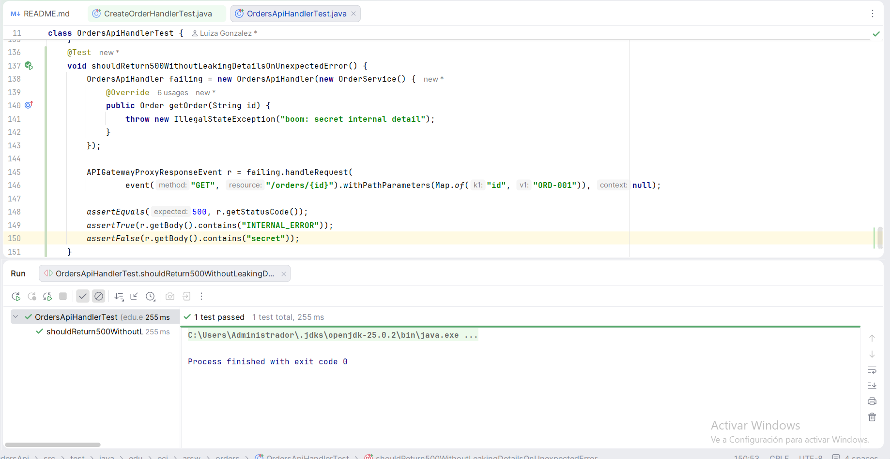
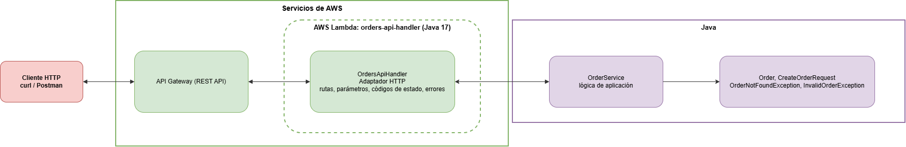

# Orders API

API REST serverless de gestión de pedidos con Java 17 y Maven, desplegada en AWS Lambda y expuesta mediante Amazon API Gateway. El taller compara dos formas de conectar la API con las funciones: transformaciones en API Gateway (mapping templates) y Lambda proxy integration con un adaptador HTTP en Java. La pregunta que guía el trabajo es: dónde debería vivir cada responsabilidad.

## Contenido

1. Contrato de la API
2. Parte I: aplicación en Java puro
3. Cómo compilar y probar
4. Parte II: primera función en AWS Lambda
5. Partes III y IV: API Gateway con mapping templates (Arquitectura A)
6. Parte V: Lambda proxy integration con adaptador HTTP (Arquitectura B)
7. Comparación de las dos arquitecturas
8. Desafío final: DELETE /orders/{id}
9. Error interno inesperado
10. Crítica a las decisiones del asistente de IA
11. Arquitectura final
12. API final
13. Documentación adicional
14. Demostración

---

## 1. Contrato de la API

| Operación | Solicitud | Éxito | Errores |
|---|---|---|---|
| Crear pedido | POST /orders con el cuerpo {customerId, product, quantity} | 201 Created, con el pedido creado y el header Location | 400 si falta un campo, está vacío, el JSON es inválido o no cumple las condiciones de negocio (por ejemplo, quantity menor o igual a 0) |
| Consultar pedido | GET /orders/{id} | 200 OK, con el pedido | 404 si no existe |
| Buscar por cliente | GET /orders?customerId={customerId} | 200 OK, con un arreglo de pedidos (vacío si el cliente no tiene) | 400 si falta customerId |
| Eliminar pedido | DELETE /orders/{id} | 204 No Content, sin cuerpo | 404 si no existe |

Cualquier operación puede devolver 500 ante un fallo inesperado.

**Formato de error**

> {
>
> "error": "ORDER_NOT_FOUND",
>
> "message": "Order ORD-999 does not exist"
>
> }

| Código | HTTP |
|---|---|
| INVALID_REQUEST | 400 |
| ORDER_NOT_FOUND | 404 |
| INTERNAL_ERROR | 500 |

Una búsqueda sin resultados no es un error: la colección existe y está vacía, por eso responde 200 con un arreglo vacío.

### Preguntas de diseño

**¿Cuáles son los recursos de tu API?**

El recurso principal de la API son los pedidos (orders). Lo podemos ver de dos formas: la colección completa de pedidos en /orders y un pedido específico en /orders/{id}. El cliente no lo traté como un recurso aparte, porque en este taller solo sirve como criterio para filtrar pedidos.

**¿Por qué elegiste /orders/{id} para consultar un pedido en particular?**

Porque el id identifica a un único pedido, y en REST lo que identifica a un recurso va en la ruta. Así la URL funciona como el "nombre" del pedido. Además, la misma URL se reutiliza con otros métodos HTTP: GET para consultarlo y DELETE para eliminarlo.

**¿Por qué customerId se representa como parámetro de consulta en la operación de búsqueda?**

Porque customerId no identifica un pedido, sino que sirve para filtrar la lista de pedidos. Seguimos consultando la colección /orders, solo que pidiendo los que pertenecen a un cliente. Los parámetros de consulta son opcionales y combinables, así que mañana se podrían agregar más filtros sin cambiar la estructura de la URL.

**¿Qué debería devolver POST /orders cuando un pedido se crea exitosamente?**

Debería devolver 201 Created, que indica que el recurso se creó, y no un simple 200. En el cuerpo va el pedido completo, incluyendo el id que asignó el servidor, para que el cliente sepa cómo referirse a él. También incluye el header Location con la dirección del nuevo pedido.

**¿Qué debería devolver la API cuando un pedido no existe?**

Un 404 Not Found con un cuerpo JSON que explique el error, por ejemplo con el código ORDER_NOT_FOUND y un mensaje como "Order ORD-999 does not exist". Así el cliente distingue claramente entre "ese pedido no existe" y otros problemas, como una solicitud mal formada (400) o un fallo del servidor (500).

**¿Qué información debería contener una respuesta de error?**

Dos cosas. Primero, un código corto y estable (como ORDER_NOT_FOUND) que un programa pueda leer sin depender del texto. Segundo, un mensaje claro para personas que explique qué pasó. Lo que nunca debe incluir son detalles internos como stack traces, nombres de clases o información de la infraestructura, porque exponerlos es un riesgo de seguridad y no le sirve al cliente. Todos los errores usan el mismo formato, para que quien consuma la API pueda manejarlos de manera uniforme.

---

## 2. Parte I: aplicación en Java puro

La lógica de negocio está en clases Java ordinarias, sin dependencias de HTTP, API Gateway, Spring Boot ni servidor web:

- Order y CreateOrderRequest: los datos.
- OrderService: crear, consultar, buscar por cliente y eliminar pedidos, con los datos en una colección en memoria.
- OrderNotFoundException e InvalidOrderException: las excepciones de dominio.

Los datos en memoria no son almacenamiento persistente: los entornos de ejecución de Lambda son efímeros.

### Checkpoint 1

**¿Se puede probar la funcionalidad de la aplicación sin AWS?**

Sí, toda la lógica de pedidos es Java, así que las pruebas se ejecutan en el mismo computador con mvn test. Solo se necesita JUnit, y no hace falta cuenta de AWS, internet ni el servicio desplegado.

**¿Tu aplicación requiere un servidor web?**

No. La aplicación es un conjunto de clases Java que se pueden llamar directamente desde las pruebas. No escucha en ningún puerto ni atiende peticiones: simplemente recibe objetos y devuelve objetos (POJO).

**¿Requiere Spring Boot?**

No. El único framework en el proyecto era JUnit, y solo para las pruebas.

**¿Qué contiene el JAR generado?**

En esta etapa contenía las clases ya compiladas del proyecto (Order, CreateOrderRequest, OrderService y las excepciones) junto con un archivo de manifiesto, sin librerías de terceros. En la versión final, empaquetada con maven-shade-plugin, el JAR también incluye aws-lambda-java-core, aws-lambda-java-events y Jackson, porque Lambda necesita un único JAR con todas sus dependencias.

**¿Qué partes de tu aplicación conocen actualmente HTTP?**

Ninguna. En este punto no existen los códigos de estado, los headers ni las rutas. Lo único que tenemos son excepciones propias del dominio, como "pedido no encontrado" o "pedido inválido", que describen qué salió mal en términos del negocio.

---

## 3. Cómo compilar y probar

**Requisitos:** JDK 17 o superior (el proyecto compila con release 17, que es el runtime que usa Lambda) y Maven 3.9 o superior.

Ejecutar las pruebas unitarias (servicio, handlers y adaptador HTTP, todas sin AWS):

    mvn test

Compilar y empaquetar (genera el JAR con dependencias):

    mvn clean package

El archivo que se sube a Lambda es target/orders-api-1.0-SNAPSHOT.jar. Maven lo reemplaza por la versión con dependencias. Los avisos del shade plugin sobre archivos solapados (MANIFEST.MF, LICENSE, module-info) son normales con Jackson y no afectan.

### Funciones Lambda

Las funciones usan el mismo JAR, Java 17, 512 MB de memoria y 15 s de timeout. El rol de ejecución es LabRole, porque AWS Academy no permite crear roles IAM.

| Arquitectura | Función | Handler |
|---|---|---|
| A | orders-create | edu.eci.arsw.orders.CreateOrderHandler::handleRequest |
| A | orders-get | edu.eci.arsw.orders.GetOrderHandler::handleRequest |
| A | orders-search | edu.eci.arsw.orders.SearchOrdersHandler::handleRequest |
| B | orders-api-handler | edu.eci.arsw.orders.OrdersApiHandler::handleRequest |

### Probar la API desplegada

Ejemplo con PowerShell (se usa curl.exe porque curl es un alias de otro comando). Los cuerpos de las solicitudes están en docs/examples/.

    $url2 = "https://tm2inxg7bd.execute-api.us-east-1.amazonaws.com/dev"

    curl.exe -i "$url2/orders/ORD-001"
    curl.exe -i "$url2/orders?customerId=CUST-42"
    curl.exe -i -X POST "$url2/orders" -H "Content-Type: application/json" -d "@docs/examples/ok.json"
    curl.exe -i -X DELETE "$url2/orders/ORD-003"

Las URL de las dos APIs desplegadas en el laboratorio son:

- Arquitectura A (mapping templates): https://ds1ph0ye0c.execute-api.us-east-1.amazonaws.com/dev
- Arquitectura B (proxy integration): https://tm2inxg7bd.execute-api.us-east-1.amazonaws.com/dev

El laboratorio de AWS Academy se apaga periódicamente, por lo que estas direcciones pueden dejar de responder. La configuración para reproducirlas está documentada en este repositorio.

---

## 4. Parte II: primera función en AWS Lambda

Desplegué CreateOrderHandler como función Lambda y la invoqué manualmente con documentos JSON.

*Prueba 1*

*Prueba 2*

*Prueba 3*

### Investigación: ¿cómo convierte Lambda el JSON en objetos Java y viceversa?

El runtime de Java de Lambda trae serialización y deserialización por defecto: el JSON de entrada se convierte en un objeto Java y lo que devuelve la función se convierte de nuevo en JSON. Con RequestHandler<I, O>, los tipos genéricos le indican al runtime a qué clases convertir, por eso mi CreateOrderHandler recibe un CreateOrderRequest y devuelve un Order sin que yo escriba código JSON.

El mapeo se hace por nombre: la serialización por defecto espera que las propiedades del JSON coincidan con los nombres en camel case de la clase Java (customerId, product, quantity). Por eso las clases son POJOs clásicos, con constructor vacío, getters y setters.

| Experimento | Entrada | Resultado |
|---|---|---|
| Entrada válida | {"customerId":"CUST-42","product":"Lavadora","quantity":1} | {"id": "ORD-001","customerId": "CUST-42","product": "Lavadora","quantity": 1 } |
| Otros valores | {"customerId":"CUST-7","product":"Celular","quantity":2} | {"id": "ORD-002","customerId": "CUST-7","product": "Celular","quantity": 2 } |
| Validación | {"customerId":"CUST-7","product":"Celular","quantity":0} | Falla con errorType edu.eci.arsw.orders.InvalidOrderException y errorMessage "quantity must be greater than 0" |
| Campo extra | {"customerId":"CUST-7","product":"Peine","quantity":7,"color":"Azul"} | Ignora el color y devuelve el JSON correspondiente |
| Tipo incorrecto | {"customerId":"CUST-7","product":"Keyboard","quantity":"abc"} | Falla con errorType java.lang.RuntimeException, errorMessage "An error occurred during JSON parsing" y stackTrace vacío |
| Objeto vacío | {} | Falla con errorType edu.eci.arsw.orders.InvalidOrderException y errorMessage "customerId is required" |

Lo que se concluye de los experimentos:

- Con un objeto vacío, el runtime sí crea el CreateOrderRequest (con el constructor vacío) y deja los campos sin asignar, por eso la validación del dominio responde "customerId is required".
- Con un tipo incorrecto, el error ocurre antes de entrar al código: el stackTrace está vacío y no aparece ninguna clase propia. Es un error genérico del runtime y la validación del dominio no llega a ejecutarse.
- Cuando el código lanza una excepción, Lambda no devuelve un 400 ni el formato de error del contrato, sino su propio JSON con errorType, errorMessage y stackTrace.

*Fuente:* https://docs.aws.amazon.com/lambda/latest/dg/java-custom-serialization.html

### Checkpoint 2

---

## 5. Partes III y IV: API Gateway con mapping templates (Arquitectura A)

En esta arquitectura, API Gateway recibe la petición HTTP, la transforma con plantillas en el JSON que espera cada función y convierte la respuesta de la Lambda en un código de estado y un error con el formato del contrato. Cada operación es una función Lambda distinta.

La configuración completa (recursos, plantillas VTL, expresiones regulares y respuestas) está en docs/api-gateway-config.md, y los ejemplos con salidas reales en docs/examples-gateway.md.

### Checkpoint 3

**¿De qué es responsable API Gateway actualmente?**

En esta primera arquitectura, API Gateway se encarga de recibir las peticiones y enviarlas a la función Lambda que corresponda, dependiendo de lo que se quiera hacer. Por ejemplo, si se quiere crear un pedido, la petición se envía a orders-create; si se quiere consultar un pedido específico, va a orders-get, y si se quieren buscar varios pedidos, se envía a orders-search.

También se encarga de extraer la información de la petición, como el ID del pedido que viene en la URL o el customerId que se envía como parámetro. Si este último no viene, lo deja como un texto vacío. Después, organiza esa información en un JSON con el formato que necesita cada función Lambda para procesarla.

Cuando Lambda devuelve una respuesta, API Gateway se encarga de definir el código de estado correspondiente: 200 si todo sale bien, 201 si se crea un pedido, 400 si hay un error en la solicitud o 404 si no se encuentra el pedido. Además, adapta los mensajes de error para que todos tengan el mismo formato, con los campos error y message. Para saber qué código de error utilizar, revisa el mensaje que devuelve Lambda y lo compara con unas expresiones regulares.

En pocas palabras, API Gateway conecta las peticiones con las funciones Lambda y se encarga de organizar tanto la información que reciben como las respuestas que devuelven.

**Ventajas**

La mayor ventaja es que el código Java no sabe nada de HTTP. Los handlers reciben un objeto sencillo y devuelven un pedido o una lista de pedidos, sin códigos de estado, headers ni rutas. Esto deja la lógica de negocio muy limpia.

Además, casi no hay código de infraestructura que escribir. No hace falta un adaptador, ni leer eventos de API Gateway, ni armar a mano las respuestas HTTP.

Otra ventaja es que se puede cambiar el contrato sin recompilar. Si quiero cambiar un código de estado o el formato de un error, edito la configuración, vuelvo a desplegar y no toco el JAR.

Por último, cada operación es una Lambda pequeña y aislada, que falla, escala y se despliega por separado.

**Desventajas**

La principal es que una parte importante de la lógica de la API vive en la consola de AWS y no en el repositorio. No se versiona ni se revisa como código, y reproducirla depende de que alguien la haya documentado a mano.

Además, el código HTTP depende del texto del mensaje de error. Si alguien cambia la frase "does not exist" en la excepción de Java, la expresión regular deja de coincidir, el 404 desaparece y el cliente recibe un 200 con el error de Lambda dentro. Es una dependencia frágil y poco visible.

También es difícil de probar de forma local. Las plantillas y las expresiones regulares solo se pueden verificar en AWS, mientras que el código Java se prueba fácilmente con mvn test.

Hay mucha configuración repetitiva: cada método necesita su plantilla de solicitud, su respuesta de método y sus filas de respuesta de integración con expresión regular y plantilla.

Tampoco cubre bien todos los errores. Cuando el JSON trae un tipo equivocado, por ejemplo "quantity": "abc", el runtime falla antes de llegar al código con un error genérico, y solo pude mapearlo agregando "JSON parsing" a la expresión regular.

Finalmente, al tener una Lambda por operación con datos en memoria, las funciones no comparten estado: un pedido creado con POST no aparece en los GET, porque cada función tiene su propia memoria.

---

## 6. Parte V: Lambda proxy integration con adaptador HTTP (Arquitectura B)

En esta arquitectura, API Gateway no transforma nada: empaqueta la petición HTTP completa en un evento y se lo entrega a una única función Lambda, orders-api-handler. Un adaptador delgado, OrdersApiHandler, es el único que conoce HTTP: enruta, lee los parámetros y el cuerpo, llama a OrderService y traduce el resultado a un código de estado.

### El evento que envía API Gateway

| Dato | Campo del evento | Método en Java |
|---|---|---|
| Método HTTP | httpMethod | getHttpMethod() |
| Ruta real | path (por ejemplo /orders/ORD-001) | getPath() |
| Ruta definida en API Gateway | resource (por ejemplo /orders/{id}) | getResource() |
| Parámetros de ruta | pathParameters | getPathParameters() |
| Parámetros de consulta | queryStringParameters | getQueryStringParameters() |
| Headers | headers | getHeaders() |
| Cuerpo | body | getBody() |

Detalles que se tuvieron en cuenta: el cuerpo llega como texto y el handler debe convertirlo con Jackson; si no hay parámetros, el campo viene como null y no como un mapa vacío; y la respuesta también debe tener un formato (statusCode, headers y body como texto), de lo contrario API Gateway responde un 502.

Eventos de ejemplo: docs/events/get-order-event.json y docs/events/post-order-event.json. La explicación completa está en docs/events/InvestigacionProxyEvent.md.

### El adaptador HTTP

Traducción de resultados a códigos de estado, en OrdersApiHandler:

| Resultado | Código |
|---|---|
| Creación exitosa | 201, con el header Location |
| Consulta o búsqueda exitosa | 200 |
| Eliminación exitosa | 204, sin cuerpo |
| OrderNotFoundException | 404 con ORDER_NOT_FOUND |
| InvalidOrderException, JSON inválido, cuerpo ausente | 400 con INVALID_REQUEST |
| Ruta o método no soportado | 404 con ROUTE_NOT_FOUND |
| Cualquier otra excepción | 500 con INTERNAL_ERROR |

**Sobre el header Location.** Lo implementé porque tras crear un recurso, el cliente necesita saber cuál es su dirección. Con Location: /orders/ORD-003 puede consultarlo sin construir la URL por su cuenta, y es la convención de REST para respuestas 201.

Una nota sobre los campos desconocidos: Jackson, por defecto, rechaza propiedades que no existen en la clase, por lo que el adaptador es más estricto que el runtime de Lambda de la Arquitectura A, que ignoró el campo extra.

### Configuración de API Gateway para la Arquitectura B

| Elemento | Valor |
|---|---|
| Tipo de API | REST API, nombre orders-api-proxy, endpoint Regional |
| Recursos | /orders y /orders/{id} |
| Métodos | ANY en /orders y ANY en /orders/{id} |
| Integración | Lambda function, con Lambda proxy integration activado |
| Función | orders-api-handler |
| Stage | dev |
| Plantillas y respuestas de integración | Ninguna: el adaptador se encarga de todo |

El recurso hijo debe llamarse exactamente {id}, porque el handler enruta por ese nombre. Cada vez que se sube un JAR nuevo basta con actualizar el código de la Lambda: la API no necesita cambios.

Ejemplos con salidas reales: docs/examples-proxy.md.

---

## 7. Comparación de las dos arquitecturas

**¿Cuál requirió más configuración de API Gateway?**

La Arquitectura A, y por mucho. Para cada una de las tres operaciones tuve que escribir una plantilla de solicitud, declarar los códigos de respuesta del método y crear filas de respuesta de integración con su expresión regular y su plantilla de error. Además, el 201 del POST exigió borrar la respuesta por defecto y crearla de nuevo. En la Arquitectura B, la configuración fue crear dos métodos ANY con la integración proxy activada y nada más: no hay plantillas, ni regex, ni códigos que declarar.

**¿Cuál requirió más código de infraestructura en Java?**

La Arquitectura B. Tuve que escribir el adaptador OrdersApiHandler, que enruta por método y ruta, lee los parámetros y el cuerpo, convierte el JSON con Jackson, elige los códigos de estado y arma los errores. También hubo que agregar dos dependencias nuevas (la librería de eventos de API Gateway y Jackson), y el JAR creció bastante. En la Arquitectura A el código de infraestructura se limitó a dos clases de entrada muy simples (GetOrderRequest y SearchOrdersRequest) y tres handlers de una línea.

**¿Cuál fue más fácil de probar localmente?**

La Arquitectura B. Con ella escribí pruebas que construyen eventos a mano y se ejecutan con mvn test, sin AWS, y cubren los códigos 201, 200, 404 y 400, el caso del JSON mal formado y la ruta desconocida. En la Arquitectura A, lo único que puedo probar en local es la lógica del servicio. Las plantillas, las regex y los códigos de estado solo se pueden verificar desplegando en AWS y llamando a la API.

**¿Dónde se definen los códigos de estado en cada enfoque?**

En la A, se definen en la consola de API Gateway, y se asignan comparando el texto del mensaje de error con una expresión regular. Por eso, si cambio la frase "does not exist" en una excepción, el 404 deja de funcionar sin que ningún test falle. En la B, se definen dentro del handler, según el tipo de excepción: OrderNotFoundException da 404, InvalidOrderException da 400 y cualquier otra da 500. Eso está versionado, revisado en el repositorio y cubierto por pruebas.

**¿Qué pasa si la API crece de 3 operaciones a 30?**

En la A, tendría que repetir manualmente todo el trabajo de configuración 30 veces, con 30 plantillas y 30 conjuntos de filas de error, cada uno atado a textos de mensajes. Es lento, propenso a errores y difícil de revisar. En la B, cada operación nueva es una ruta más en el handler, pero ese handler puede crecer demasiado si no se organiza. Habría que separarlo en clases por recurso, o usar una tabla de rutas, para que no se convierta en un bloque gigante. Además, con una sola Lambda, un fallo o un arranque en frío afecta a toda la API.

**¿Cuál hace más limpia la lógica de negocio en Java?**

En los dos casos, OrderService quedó intacto y sin conocer HTTP. La diferencia está en dónde queda el acoplamiento. En la A, el código Java parece limpio, pero en realidad depende del texto de sus mensajes de error, porque una regex en la consola los interpreta. Ese acoplamiento es invisible. En la B, el conocimiento de HTTP se concentra en una sola clase, el adaptador, y el servicio se mantiene totalmente ajeno. Por eso considero más limpia la B: la dependencia es explícita y está en un único lugar.

**¿Cuál sería más fácil de entender para otro desarrollador?**

La B. Quien abra el repositorio ve todo el comportamiento de la API en código Java, con pruebas que lo documentan. En la A, para entender qué hace la API hay que entrar a la consola de AWS, leer plantillas en VTL y expresiones regulares, y confiar en que la documentación escrita a mano esté al día.

**¿Cuál elegiría para un sistema más grande? ¿Por qué?**

La B, la integración proxy con un adaptador. La razón principal es que mantiene las decisiones de HTTP en código que se versiona, se revisa y se prueba, mientras que en la A viven en una consola, sin pruebas y atadas a textos frágiles. Lo evidenciaron dos casos de mi trabajo: el error de deserialización con "quantity": "abc", que en la A produjo un error genérico y en la B un 400 con el formato del contrato, y la dependencia del texto de los mensajes de error.

Aun así, la B tiene costos que habría que manejar: un JAR más pesado, un handler que hay que organizar para que no crezca desordenado, y el riesgo de que una sola función concentre todos los fallos. Para un sistema grande lo organizaría por recursos o por grupos de operaciones. La A podría tener sentido en casos muy simples, con pocas rutas que casi no cambien, o cuando no se quiere tocar el código de una función existente.

---

## 8. Desafío final: DELETE /orders/{id}

### Predicción antes de implementar

Esta predicción se escribió antes de implementar el cambio y antes de consultar al asistente de IA. Se asume que la operación se agrega a la Arquitectura B (Lambda proxy integration con el adaptador HTTP).

**1. ¿Qué clases Java deberían cambiar?**

Debería cambiar OrdersApiHandler, para que acepte el método DELETE y maneje los errores y las respuestas de esta operación. También debería cambiar OrderService, que es donde debe estar la lógica para eliminar un pedido. Pienso agregar dos operaciones: una que elimine un solo pedido y otra que elimine todos los pedidos de un cliente.

**2. ¿Necesito una nueva función Lambda?**

No. Ya existe una sola función Lambda que atiende toda la API (orders-api-handler), así que solo hay que agregar el método DELETE a su código.

**3. ¿Necesita cambiar la configuración de API Gateway?**

Para la Arquitectura B, no. Solo hace falta actualizar el JAR de la Lambda.

**4. ¿Dónde debería residir la lógica de eliminación?**

En OrderService.

**5. ¿Dónde debería residir la decisión de devolver 204 o 404?**

En OrdersApiHandler.

**6. ¿Qué pruebas deberían agregarse?**

- Que se elimine un pedido existente.
- Que se eliminen los pedidos de un cliente.
- Que no se elimine ningún otro pedido distinto del que se pidió eliminar.

### Predicción frente a la propuesta del asistente

Antes de implementar el DELETE escribí una predicción y le hice commit. Después le pedí una propuesta al asistente de IA y comparé las dos.

**Lo que coincidió.** Acerté en lo esencial de la arquitectura. Predije que cambiarían OrdersApiHandler y OrderService, y la propuesta del asistente fue la misma. Predije que no hacía falta una nueva función Lambda, porque la Arquitectura B ya tiene una sola función que atiende toda la API, y también que no había que tocar API Gateway, porque el método ANY de /orders/{id} ya enruta el DELETE, de modo que solo había que subir el JAR nuevo. Predije que la lógica de eliminación debía vivir en OrderService y que la decisión entre 204 y 404 debía vivir en OrdersApiHandler, y ambas cosas se confirmaron. En el servicio quedó el hecho de dominio (el pedido existe o no existe, que se expresa con una excepción) y en el handler quedó la traducción a un código HTTP.

**Lo que no coincidió.** Primero, el alcance. Mi predicción incluía eliminar también todos los pedidos de un cliente. El enunciado solo pide DELETE /orders/{id}, así que el asistente no lo incluyó. Lo considero una mejora opcional y no una parte del requisito, porque exige decidir cosas que el contrato actual no define, como qué responder si el cliente no tiene pedidos o si conviene permitir un borrado masivo a partir de un parámetro de consulta.

Segundo, las pruebas. Yo había pensado en eliminar un pedido, eliminar los de un cliente y comprobar que no se borra ningún otro. No había incluido el caso que el enunciado exige expresamente, el de un pedido inexistente que debe dar 404. El asistente lo agregó, junto con una comprobación de que, tras borrar un pedido, una consulta posterior ya no lo encuentra. Mi idea de verificar que no se borre otro pedido sí se mantuvo.

Tercero, un detalle que no anticipé. Una respuesta 204 no puede llevar cuerpo, y el método que usa el handler para construir respuestas siempre agrega un cuerpo JSON, así que hizo falta un método aparte, noContent(), que devuelve solo el código de estado. También me faltó mencionar que, aunque no cambie nada en API Gateway, hay que volver a subir el código de la Lambda para que el cambio tenga efecto.

**Qué habría pasado en la Arquitectura A.** Mi predicción asumía la Arquitectura B. Si hubiera extendido la A, la respuesta habría sido muy distinta: una nueva función Lambda para el borrado, un método DELETE en /orders/{id} con su plantilla de solicitud, una respuesta 204 declarada en el método y una fila de respuesta de integración para el 404 con su expresión regular y su plantilla de error. Es otro ejemplo de que añadir una operación cuesta mucho más en la A que en la B.

**Resultado en la API desplegada.** La API respondió como se esperaba. Creé un pedido y lo eliminé: el DELETE devolvió 204 sin cuerpo. Al consultar el mismo pedido, devolvió 404 con ORDER_NOT_FOUND, y al intentar eliminar un pedido que no existe también devolvió 404 con ORDER_NOT_FOUND. En la respuesta 204, API Gateway agregó por su cuenta los headers Content-Type y Content-Length con valor 0, aunque el handler no devolvió cuerpo. No afecta al comportamiento.

**Conclusión.** Mi razonamiento sobre dónde debe vivir cada responsabilidad fue correcto. Donde me quedé corto fue en los casos de prueba y en los detalles propios de HTTP, como que el 204 no lleva cuerpo.

---

## 9. Error interno inesperado

Cuando ocurre una excepción inesperada, el método handleRequest de OrdersApiHandler no la reconoce en sus catch específicos y la atrapa en el último, catch (Exception e). Ahí la registra en CloudWatch y responde con un 500 y el código INTERNAL_ERROR, con un mensaje genérico que no expone detalles internos. Se comprobó con la prueba shouldReturn500WithoutLeakingDetailsOnUnexpectedError de OrdersApiHandlerTest.

---

## 10. Crítica a las decisiones del asistente de IA

Evalué tres decisiones de ingeniería que propuso el asistente, sin tener en cuenta si el código compiló.

### Decisión 1: una sola Lambda para toda la API (Arquitectura B)

**Decisión del agente.** Propuso una única función, orders-api-handler, que atiende todas las operaciones, en lugar de una función por operación como hice en la Arquitectura A.

**Por qué creo que la propuso.** Con la integración proxy, la función recibe la petición HTTP completa, así que ya no hay una razón técnica para separar las operaciones. Además, resuelve un problema que tuve en la A: como los datos viven en memoria y cada función tiene la suya, un pedido creado con POST no existía para los GET.

**Si estoy de acuerdo.** En parte. Para una API pequeña funciona bien: después de un POST, el GET encontró el pedido, y agregar el DELETE no exigió ninguna función nueva. El costo es que todas las operaciones comparten el arranque en frío y los fallos, y que el handler crece con cada ruta nueva.

**Alternativa.** Una función por operación, o una por recurso.

**Qué implementé y por qué.** Una sola función, porque con cuatro operaciones la simplicidad pesa más. Si la API creciera bastante, separaría el handler en clases por recurso.

### Decisión 2: errores por tipo de excepción y no por el texto del mensaje

**Decisión del agente.** El adaptador asigna el código HTTP según la clase de la excepción: OrderNotFoundException da 404, InvalidOrderException da 400 y cualquier otra da 500. En la Arquitectura A, en cambio, el código dependía de expresiones regulares sobre el texto del mensaje.

**Por qué creo que la propuso.** Un texto es frágil, porque cambiar una frase rompe el mapeo sin que ninguna prueba falle. El tipo de excepción, en cambio, forma parte del código: lo comprueba el compilador y se puede probar con mvn test.

**Si estoy de acuerdo.** Sí, es la decisión que más valor me aportó. Lo comprobé con el caso de quantity escrito como texto: en la A produjo un error genérico del runtime y tuve que agregar una regex para mapearlo, mientras que en la B devolvió un 400 con el formato del contrato, verificado por una prueba.

**Alternativa.** Mantener las expresiones regulares en API Gateway, o devolver resultados con códigos de error en lugar de usar excepciones.

**Qué implementé y por qué.** El mapeo por tipo de excepción dentro del handler, porque deja las decisiones de HTTP en código versionado y probado.

### Decisión 3: enrutar por resource y método HTTP

**Decisión del agente.** El handler decide qué hacer comparando el campo resource (por ejemplo /orders/{id}) y el método HTTP, y no analizando el texto de la ruta real.

**Por qué creo que la propuso.** El campo resource ya trae la plantilla de la ruta y el id llega separado en pathParameters, así que no hay que partir la URL a mano.

**Si estoy de acuerdo.** Sí, con una advertencia: el código queda atado al nombre exacto del recurso en la consola de AWS. Si el recurso no se llama {id}, el handler responde ROUTE_NOT_FOUND aunque la ruta exista. Es un acoplamiento con una configuración que no está en el repositorio, parecido al de la Arquitectura A pero mucho menor.

**Alternativa.** Analizar la ruta real con expresiones regulares, o usar un framework de enrutamiento.

**Qué implementé y por qué.** Enrutar por resource, por claridad y porque no agrega dependencias. Documenté que el recurso debe llamarse exactamente {id}.

### Observación adicional

No todas las indicaciones del asistente fueron correctas. Me indicó cambiar de 200 a 201 la respuesta de integración por defecto, pero la consola no permite editar ese campo y hubo que eliminarla y crearla de nuevo. También me dio comandos de bash que no funcionan en PowerShell. Esto me enseñó a verificar cada paso contra el comportamiento real y no confiar en una indicación solo porque suena segura.

---

## 11. Arquitectura final

Arquitectura B: Lambda proxy integration con un adaptador HTTP. Las flechas indican la dirección de la comunicación y los colores indican qué depende de AWS y qué es Java ordinario.

- Verde: depende de AWS. API Gateway y Lambda son servicios de AWS, y OrdersApiHandler usa las clases de eventos de aws-lambda-java-events.
- Morado: Java ordinario. OrderService, Order, CreateOrderRequest y las excepciones no conocen HTTP ni AWS y se prueban con mvn test.
- Rojo: el cliente.

### Dónde vive cada responsabilidad

| Responsabilidad | Componente |
|---|---|
| Exponer la URL pública y entregar la petición a la función | API Gateway |
| Ejecutar el código Java y convertir el evento en objetos | AWS Lambda |
| Enrutar por método y ruta, leer parámetros y body, elegir el código de estado, dar formato a los errores | OrdersApiHandler |
| Crear, consultar, buscar y eliminar pedidos, y validar los datos | OrderService |

---

## 12. API final

| Operación | Éxito | Errores demostrados |
|---|---|---|
| POST /orders | 201 Created, con header Location | 400 (quantity en 0, tipo incorrecto, JSON inválido) |
| GET /orders/{id} | 200 OK | 404 |
| GET /orders?customerId={customerId} | 200 OK (arreglo, vacío si no hay pedidos) | 400 si falta customerId |
| DELETE /orders/{id} | 204 No Content | 404 |

Ante un error interno inesperado, el sistema responde 500 con INTERNAL_ERROR (ver sección 9).

---

## 13. Documentación adicional

- docs/api-gateway-config.md: cómo reproducir la Arquitectura A (plantillas, expresiones regulares y respuestas).
- docs/examples-gateway.md: solicitudes y respuestas reales de la Arquitectura A.
- docs/examples-proxy.md: solicitudes y respuestas reales de la Arquitectura B.
- docs/events/: ejemplos del evento de Lambda proxy integration y la investigación (InvestigacionProxyEvent.md).
- docs/examples/: los cuerpos JSON usados en las pruebas con curl.
- evidencia/: capturas de pantalla de las pruebas.

---

## 14. Demostración

Video de la demostración: [ver en YouTube](https://youtu.be/dZa7s_9WCHg)

Copia en OneDrive: [ver en OneDrive](https://pruebacorreoescuelaingeduco-my.sharepoint.com/:v:/g/personal/luiza_gonzalez-v_mail_escuelaing_edu_co/IQBqQ_PvppuUSJkVau6ySvNbAZo4FwdIigJlJxCIHy4ezA8?e=dF0dUH)

El video muestra la ejecución de mvn test y mvn package, la invocación directa de una Lambda, la API desplegada con un
POST exitoso, un GET exitoso, un 404, un 400, el DELETE y el diagrama de arquitectura.