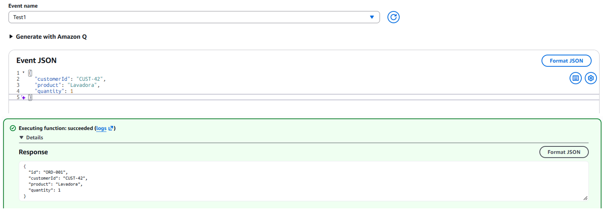
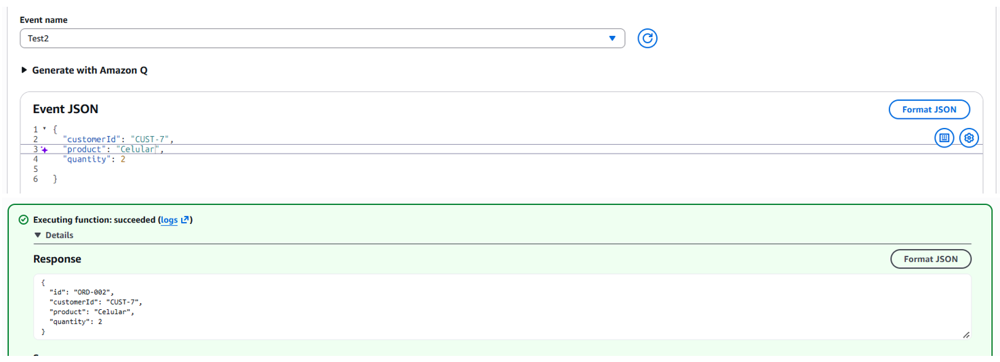
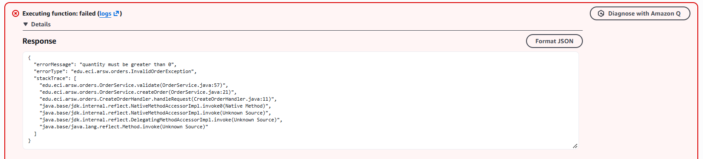
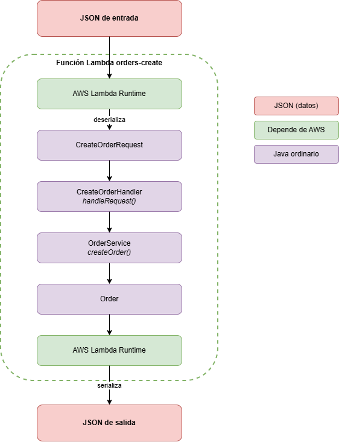
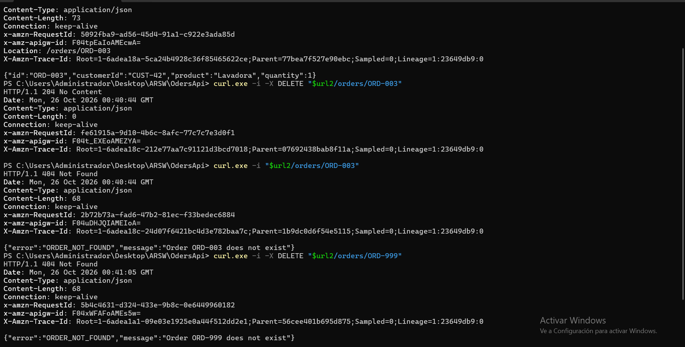

# OdersApi
Order Management API: Java 17 + Maven 
on AWS Lambda, exposed via API Gateway (mapping templates vs. Lambda proxy). Workshop on architectural responsibilities.

## Fase 0: Contrato de la API

| Operacion  | Request | Exito | Errores                                                                                         |
|------------|---------|-------|-------------------------------------------------------------------------------------------------|
|Crear pedido| POST /orders y el body {customerId, product, quantity}|201 Created | 400 si falta un campo, esta vacio o el JSon es invalido o condiciones de negocio no lo érmitesn |
|Consultar pedido| GET /orders/{id}|200 OK, más el pedido que quiere | 404 si no existe                                                                                |
|Buscar por cliente|GET /orders?customerId=*id*|200 OK, mas el array con los pedidos | 400 si falta el customer Id y 404 si no existe.                                                 |
|Eliminar pedido| DELETE /orders/{id}|204 No content| 404 si no existe  |

**Formato de error**
> {
> 
> "error": "ORDER_NOT_FOUND",
> 
> "message": "Order ORD-999 does not exist"
> 
> }

| Codigo | HTTP |
|--------|------|
|INVALID_REQUEST| 400 |
|ORDER_NOT_FOUND|404|
|INTERNAL_ERROR|500|

**Preguntas**

- ¿Cuáles son los recursos de tu API?

  R/: El recurso principal de la API son los pedidos (orders). Lo podemos ver de dos formas: la colección completa de 
  pedidos en /orders y un pedido específico en /orders/{id}. El cliente no lo traté como un recurso aparte, porque en
  este lab solo sirve como criterio para filtrar pedidos.

- ¿Por qué elegiste /orders/{id} para consultar un pedido en particular?

  R/:Porque el id identifica a un único pedido, y en REST lo que identifica a un recurso va en la ruta. Así la URL 
  funciona como el “nombre” del pedido.

- ¿Por qué customerId se representa como parámetro de consulta en la operación de búsqueda?
  
  R/:Porque customerId no identifica un pedido, sino que sirve para filtrar la lista de pedidos. Seguimos consultando 
  la colección /orders, solo que pidiendo los que pertenecen a un cliente. 

- ¿Qué debería devolver POST /orders cuando un pedido se crea exitosamente?

  R/:Debería devolver 201 Created, que indica que el recurso se creó, y no un simple 200. En el cuerpo va el pedido
  completo, incluyendo el id que asignó el servidor, para que el cliente sepa cómo referirse a él.

- ¿Qué debería devolver la API cuando un pedido no existe?

  R/:Un 404 Not Found con un cuerpo JSON que explique el error, por ejemplo con el código ORDER_NOT_FOUND y un mensaje 
  como “Order ORD-999 does not exist”. Así el cliente distingue claramente entre “ese pedido no existe”.

- ¿Qué información debería contener una respuesta de error?

  R/:Dos cosas. Primero, un código corto y estable (como ORDER_NOT_FOUND) que un programa pueda leer sin depender del 
  texto. Segundo, un mensaje claro para personas que explique qué pasó. Lo que nunca debe incluir son detalles internos 
  como stack traces, nombres de clases o información de la infraestructura, porque exponerlos es un riesgo de seguridad
  y no le sirve al cliente. Todos los errores usan el mismo formato, para que quien consuma la API pueda manejarlos de
  manera uniforme.

## Fase 1: Implementar la aplicación en Java puro

- ¿Se puede probar la funcionalidad de la aplicación sin AWS?

R/:Sí, toda la lógica de pedidos es Java, así que las pruebas se pueden ejecutar en el mismo computador con mvn test, solo
se necesita JUnit, y no hace falta cuenta de AWS, internet ni el servicio desplegado.

- ¿Tu aplicación requiere un servidor web?

R/: No, la aplicación es un conjunto de clases Java que se pueden llamar directamente desde las pruebas, no escucha en 
ningún puerto ni atiende peticiones, simplemente recibe objetos y devuelve objetos(POJO).

- ¿Requiere Spring Boot?
R/:No, El único framework en el proyecto es JUnit, y solo para las pruebas.

- ¿Qué contiene el JAR generado?

R/:Contiene las clases ya compiladas del proyecto (Order, CreateOrderRequest, OrderService y las dos excepciones) junto
con un archivo de manifiesto con metadatos. Por ahora no trae librerías de terceros, porque el proyecto no depende 
de ninguna en producción. Más adelante, cuando agreguemos las librerías de AWS Lambda, el JAR tendrá que incluirlas.

- ¿Qué partes de tu aplicación conocen actualmente HTTP?

R/:Ninguna. En este punto no existen los códigos de estado, los headers ni las rutas. Lo único que tenemos son
excepciones propias del dominio, como “pedido no encontrado” o “pedido inválido”, que describen qué salió mal en 
términos del negocio.

## Parte II:Desplegar una función Java en AWS Lambda
*Prueba1*

*Prueba2*

*Prueba3*

- ¿cómo convierte Lambda el JSON en objetos Java y viceversa?
El runtime de Java de Lambda trae serialización y deserialización por defecto: el JSON de entrada se convierte en un 
objeto Java y lo que devuelve la función se convierte de nuevo en JSON. Con RequestHandler<I, O>, los tipos genéricos 
le indican al runtime a qué clases convertir, por eso mi CreateOrderHandler recibe un CreateOrderRequest y devuelve un 
Order sin que yo escriba código JSON.

El mapeo se hace por nombre: la serialización por defecto espera que las propiedades del JSON coincidan con los nombres 
en camel case de la clase Java (customerId, product, quantity).

| Experimento | Entrada                                                      | Resultado                                                                                                              |
|---|--------------------------------------------------------------|------------------------------------------------------------------------------------------------------------------------|
| Entrada válida | {"customerId":"CUST-42","product":"Lavadora","quantity":1}   | **{"id": "ORD-001","customerId": "CUST-42","product": "Lavadora","quantity": 1 }**                                     |
| Otros valores | {"customerId":"CUST-7","product":"Celular","quantity":2}     | **{"id": "ORD-002","customerId": "CUST-7","product": "Celular","quantity": 2 }**                                       |
| Validación | {"customerId":"CUST-7","product":"Celular","quantity":0}     | Falla con **errorType: edu.eci.arsw.orders.InvalidOrderException** y **errorMessage: quantity must be greater than 0** |
| Campo extra | {"customerId":"CUST-7","product":"Peine","quantity":7,"color":"Azul"} | Ignora el color y devuelve el json correspondiente                                                                     |
| Tipo incorrecto | {"customerId":"CUST-7","product":"Keyboard","quantity":"abc"} | **Falla con errorType: java.lang.RuntimeException, errorMessage: An error occurred during JSON parsing y stackTrace vacío**                                                                                                                   |
| Objeto vacío |{}                                                            | **Falla con errorType: java.lang.RuntimeException, errorMessage: An error occurred during JSON parsing y stackTrace vacío**                                                                                                         |

*Fuente:* https://docs.aws.amazon.com/lambda/latest/dg/java-custom-serialization.html

## Parte 3 y 4: Diseñar la interfaz HTTP y mapeo en API Gateway

- ¿De qué es responsable API Gateway actualmente?

R/: En esta primera arquitectura, API Gateway se encarga de recibir las peticiones y enviarlas a la función Lambda que 
corresponda, dependiendo de lo que se quiera hacer. Por ejemplo, si se quiere crear un pedido, la petición se envía a 
orders-create; si se quiere consultar un pedido específico, va a orders-get, y si se quieren buscar varios pedidos,
se envía a orders-search.

También se encarga de extraer la información de la petición, como el ID del pedido que viene en la URL o el customerId
que se envía como parámetro. Si este último no viene, lo deja como un texto vacío. Después, organiza esa información en
un JSON con el formato que necesita cada función Lambda para procesarla.

Cuando Lambda devuelve una respuesta, API Gateway se encarga de definir el código de estado correspondiente, por ejemplo,
200 si todo sale bien, 201 si se crea un pedido, 400 si hay un error en la solicitud o 404 si no se encuentra el pedido. Además, 
adapta los mensajes de error para que todos tengan el mismo formato, con los campos error y message. Para saber
qué código de error utilizar, revisa el mensaje que devuelve Lambda y lo compara con unas expresiones regulares.

En pocas palabras, API Gateway conecta las peticiones con las funciones Lambda y se encarga de organizar tanto la 
información que reciben como las respuestas que devuelven.

**Ventajas**

La mayor ventaja es que el código Java no sabe nada de HTTP. Los handlers reciben un objeto sencillo y devuelven un pedido o una lista de pedidos, sin códigos de estado, headers ni rutas. Esto deja la lógica de negocio muy limpia.

Además, casi no hay código de infraestructura que escribir. No hace falta un adaptador, ni leer eventos de API Gateway, ni armar a mano las respuestas HTTP.

Otra ventaja es que se puede cambiar el contrato sin recompilar. Si quiero cambiar un código de estado o el formato de un error, edito la configuración, vuelvo a desplegar y no toco el JAR.

Por último, cada operación es una Lambda pequeña y aislada, que falla, escala y se despliega por separado.

**Desventajas**

La principal es que una parte importante de la lógica de la API vive en la consola de AWS y no en el repositorio. No se versiona ni se revisa como código, y reproducirla depende de que alguien la haya documentado a mano.

Además, el código HTTP depende del texto del mensaje de error. Si alguien cambia la frase “does not exist” en la excepción de Java, la expresión regular deja de coincidir, el 404 desaparece y el cliente recibe un 200 con el error de Lambda dentro. Es una dependencia frágil y poco visible.

También es difícil de probar de forma local. Las plantillas y las expresiones regulares solo se pueden verificar en AWS, mientras que el código Java se prueba fácilmente con mvn test.

## Comparación de arquitecturas

- ¿Cuál requirió más configuración de API Gateway?

R/:La Arquitectura A, y por mucho. Para cada una de las tres operaciones tuve que escribir una plantilla de solicitud,
declarar los códigos de respuesta del método y crear filas de respuesta de integración con su expresión regular y su 
plantilla de error. Además, el 201 del POST exigió borrar la respuesta por defecto y crearla de nuevo. En la Arquitectura B,
la configuración fue crear dos métodos ANY con la integración proxy activada y nada más: no hay plantillas, ni regex, ni códigos que declarar.

- ¿Cuál requirió más código de infraestructura en Java?

R/: La Arquitectura B. Tuve que escribir el adaptador OrdersApiHandler, que enruta por método y ruta, lee los parámetros y 
el cuerpo, convierte el JSON con Jackson, elige los códigos de estado y arma los errores. También hubo que agregar dos
dependencias nuevas (la librería de eventos de API Gateway y Jackson),
y el JAR creció bastante. En la Arquitectura A el código de infraestructura se limitó a dos clases de entrada muy 
simples (GetOrderRequest y SearchOrdersRequest) y tres handlers de una línea.

- ¿Cuál fue más fácil de probar localmente?

La Arquitectura B. Con ella escribí 10 pruebas que construyen eventos a mano y se ejecutan con mvn test, sin AWS, y 
cubren los códigos 201, 200, 404 y 400, el caso del JSON mal formado y la ruta desconocida. En la Arquitectura A, 
lo único que puedo probar en local es la lógica del servicio. Las plantillas, las regex y los códigos de estado solo
se pueden verificar desplegando en AWS y llamando a la API.

- ¿Dónde se definen los códigos de estado en cada enfoque?

R/: En la A, se definen en la consola de API Gateway, y se asignan comparando el texto del mensaje de error con una 
expresión regular. Por eso, si cambio la frase “does not exist” en una excepción, 
el 404 deja de funcionar sin que ningún test falle. En la B, se definen dentro del handler, según el tipo de excepción:
OrderNotFoundException da 404, InvalidOrderException da 400 y cualquier otra da 500.

- ¿Qué pasa si la API crece de 3 operaciones a 30?

R/: En la A, tendría que repetir manualmente todo el trabajo de configuración 30 veces, con 30 plantillas y 30 conjuntos de 
filas de error, cada uno atado a textos de mensajes. Es lento, propenso a errores y difícil de revisar. En la B, cada operación
nueva es una ruta más en el handler, pero ese handler puede crecer demasiado si no se organiza. Habría que separarlo en clases por recurso,

- ¿Cuál hace más limpia la lógica de negocio en Java?

R/: En los dos casos, OrderService quedó intacto y sin conocer HTTP. La diferencia está en dónde queda el acoplamiento.
En la A, el código Java parece limpio, pero en realidad depende del texto de sus mensajes de error, porque una regex en 
la consola los interpreta. Ese acoplamiento es invisible. En la B, el conocimiento de HTTP se concentra en una sola
clase, el adaptador, y el servicio se mantiene totalmente ajeno. Por eso considero más limpia la B: la dependencia es 
explícita y está en un único lugar.

- ¿Cuál sería más fácil de entender para otro desarrollador?

R/: La B. Quien abra el repositorio ve todo el comportamiento de la API en código Java, con pruebas que lo documentan. 
En la A, para entender qué hace la API hay que entrar a la consola de AWS, leer plantillas y confiar en que la documentación.

- ¿Cuál elegiría para un sistema más grande? ¿Por qué?

R/: La B, la integración proxy con un adaptador. La razón principal es que mantiene las decisiones de HTTP en código 
que se versiona, se revisa y se prueba, mientras que en la A viven en una consola, sin pruebas y atadas a textos frágiles.

## Predicción antes de implementar DELETE /orders/{id}

Esta predicción se escribió antes de implementar el cambio y antes de consultar al asistente de IA. Se asume que la operación se agrega a la Arquitectura B (Lambda proxy integration con el adaptador HTTP).

## 1. ¿Qué clases Java deberían cambiar?

Debería cambiar OrdersApiHandler, para que acepte el método DELETE y maneje los errores y las respuestas de esta operación. También debería cambiar OrderService, que es donde debe estar la lógica para eliminar un pedido. Pienso agregar dos operaciones: una que elimine un solo pedido y otra que elimine todos los pedidos de un cliente.

## 2. ¿Necesito una nueva función Lambda?

No. Ya existe una sola función Lambda que atiende toda la API (orders-api-handler), así que solo hay que agregar el método DELETE a su código.

## 3. ¿Necesita cambiar la configuración de API Gateway?

Para la Arquitectura B, no. Solo hace falta actualizar el JAR de la Lambda.

## 4. ¿Dónde debería residir la lógica de eliminación?

En OrderService.

## 5. ¿Dónde debería residir la decisión de devolver 204 o 404?

En OrdersApiHandler.

## 6. ¿Qué pruebas deberían agregarse?

- Que se elimine un pedido existente.
- Que se eliminen los pedidos de un cliente.
- Que no se elimine ningún otro pedido distinto del que se pidió eliminar.

# DELETE /orders/{id}: predicción frente a la propuesta del asistente

Antes de implementar el DELETE escribí una predicción y le hice commit (docs/prediccion-delete.md). Después le pedí una propuesta al asistente de IA y comparé las dos. Este documento recoge esa comparación y el resultado final.

## Lo que coincidió

Acerté en lo esencial de la arquitectura. Predije que cambiarían OrdersApiHandler y OrderService, y la propuesta del asistente fue la misma. Predije que no hacía falta una nueva función Lambda, porque la Arquitectura B ya tiene una sola función que atiende toda la API, y también que no había que tocar API Gateway, porque el método ANY de /orders/{id} ya enruta el DELETE, de modo que solo había que subir el JAR nuevo. Predije que la lógica de eliminación debía vivir en OrderService y que la decisión entre 204 y 404 debía vivir en OrdersApiHandler, y ambas cosas se confirmaron. En el servicio quedó el hecho de dominio (el pedido existe o no existe, que se expresa con una excepción) y en el handler quedó la traducción a un código HTTP.

## Lo que no coincidió

Primero, el alcance. Mi predicción incluía eliminar también todos los pedidos de un cliente. El enunciado solo pide DELETE /orders/{id}, así que el asistente no lo incluyó. Lo considero una mejora opcional y no una parte del requisito, porque exige decidir cosas que el contrato actual no define, como qué responder si el cliente no tiene pedidos o si conviene permitir un borrado masivo a partir de un parámetro de consulta.

Segundo, las pruebas. Yo había pensado en eliminar un pedido, eliminar los de un cliente y comprobar que no se borra ningún otro. No había incluido el caso que el enunciado exige expresamente, el de un pedido inexistente que debe dar 404. El asistente lo agregó, junto con una comprobación de que, tras borrar un pedido, una consulta posterior ya no lo encuentra. Mi idea de verificar que no se borre otro pedido sí se mantuvo.

Tercero, un detalle que no anticipé. Una respuesta 204 no puede llevar cuerpo, y el método que usa el handler para construir respuestas siempre agrega un cuerpo JSON, así que hizo falta un método aparte, noContent(), que devuelve solo el código de estado. También me faltó mencionar que, aunque no cambie nada en API Gateway, hay que volver a subir el código de la Lambda para que el cambio tenga efecto.

## Qué habría pasado en la Arquitectura A

Mi predicción asumía la Arquitectura B. Si hubiera extendido la A, la respuesta habría sido muy distinta: una nueva función Lambda para el borrado, un método DELETE en /orders/{id} con su plantilla de solicitud, una respuesta 204 declarada en el método y una fila de respuesta de integración para el 404 con su expresión regular y su plantilla de error. Es otro ejemplo de que añadir una operación cuesta mucho más en la A que en la B.

## Resultado en la API desplegada

La API respondió como se esperaba. Creé un pedido y lo eliminé: el DELETE devolvió 204 sin cuerpo. Al consultar el mismo pedido, devolvió 404 con ORDER_NOT_FOUND, y al intentar eliminar un pedido que no existe también devolvió 404 con ORDER_NOT_FOUND.

Un detalle que observé: en la respuesta 204, API Gateway agregó por su cuenta los headers Content-Type: application/json y Content-Length: 0, aunque el handler no devolvió cuerpo. No afecta al comportamiento.

## Conclusión

Mi razonamiento sobre dónde debe vivir cada responsabilidad fue correcto. Donde me quedé corto fue en los casos de prueba y en los detalles propios de HTTP, como que el 204 no lleva cuerpo.

